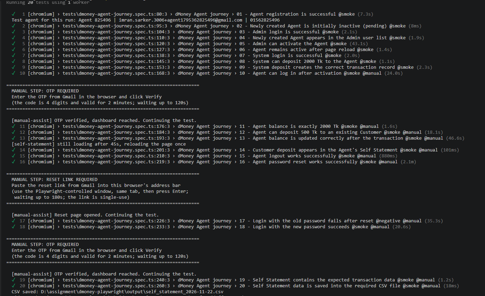
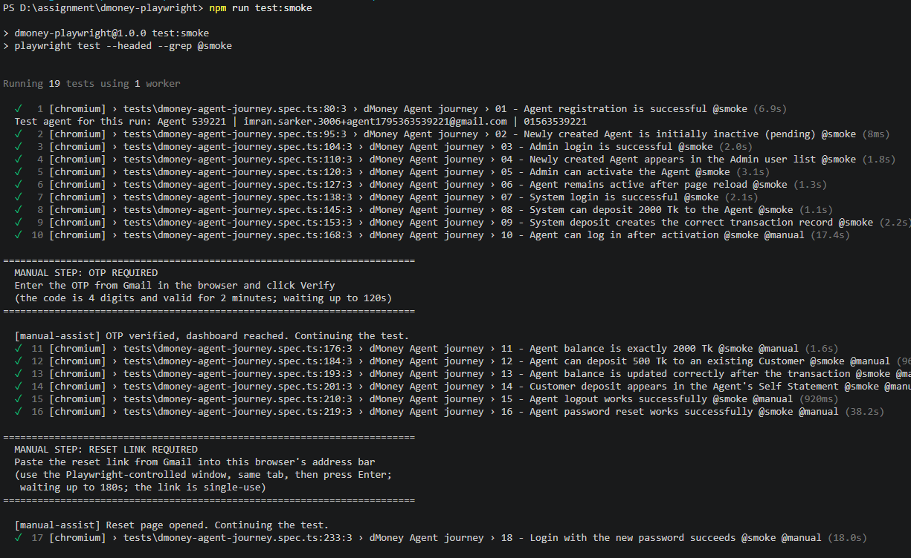

# dMoney Portal — Playwright E2E Automation

End-to-end automation of the **Agent journey** on the dMoney Portal
(<https://dmoneyportal.roadtocareer.net>) using **Playwright + TypeScript**, with an AI
harness for Claude Code in [`.claude/`](.claude).

---

## 📹 Automation video (headed mode)

Full regression run (all 20 tests, headed Chromium):

▶️ **[Watch the automation video (docs/videos/regression-run.webm)](docs/videos/regression-run.webm)**

GitHub opens the file page; click **View raw** (or Download) to play it in the browser.

## ✅ Regression Test Result



## 💨 SmokeTest Result



---

## Scenario covered

| # | Test (title in the report) | Tag |
|---|---|---|
| 01 | Agent registration is successful | `@smoke` |
| 02 | Newly created Agent is initially inactive (pending) | `@smoke` |
| 03 | Admin login is successful | `@smoke` |
| 04 | Newly created Agent appears in the Admin user list | `@smoke` |
| 05 | Admin can activate the Agent | `@smoke` |
| 06 | Agent remains active after page reload (+ Admin logout) | `@smoke` |
| 07 | System login is successful | `@smoke` |
| 08 | System can deposit 2000 Tk to the Agent | `@smoke` |
| 09 | System deposit creates the correct transaction record (+ System logout) | `@smoke` |
| 10 | Agent can log in after activation | `@smoke @manual` |
| 11 | Agent balance is exactly 2000 Tk | `@smoke @manual` |
| 12 | Agent can deposit 500 Tk to an existing Customer | `@smoke @manual` |
| 13 | Agent balance is updated correctly after the transaction | `@smoke @manual` |
| 14 | Customer deposit appears in the Agent's Self Statement | `@smoke @manual` |
| 15 | Agent logout works successfully | `@smoke @manual` |
| 16 | Agent password reset works successfully | `@smoke @manual` |
| 17 | Login with the old password fails after reset | `@negative @manual` |
| 18 | Login with the new password succeeds | `@smoke @manual` |
| 19 | Self Statement contains the expected transaction data | `@smoke @manual` |
| 20 | Self Statement data is saved into the required CSV file | `@smoke @manual` |

- **Regression suite** = all 20 tests.
- **Smoke suite** = only positive tests (`@smoke`), i.e. everything except test 17.
- Expected agent balance after step 12 is **1512.50 Tk**: 2000 − 500 + 12.50 (the agent
  earns a 2.5% commission on every cash-in).
- The statement is exported to `output/self_statement_YYYY-MM-DD.csv` (today's date).

## Project structure

```
.claude/                 AI harness (settings, sub-agents, slash commands)
docs/app-map.md          Explored app map: pages, locators, API, risks
pages/                   Page Objects
tests/dmoney-agent-journey.spec.ts   The 20 serial test steps
utils/                   env, test data, CSV writer, manual-assist helpers
output/                  Generated self_statement_<date>.csv
CLAUDE.md                Project instructions for Claude Code
.mcp.json                Playwright MCP server (browser for the AI agent)
```

## Setup

```bash
npm ci
npx playwright install chromium
cp .env.example .env      # then set AGENT_GMAIL to your own Gmail address
```

| `.env` key | Meaning |
|---|---|
| `ADMIN_EMAIL` / `ADMIN_PASSWORD` | Admin account (`admin@dmoney.com` / `1234`) |
| `SYSTEM_EMAIL` / `SYSTEM_PASSWORD` | System account (`system@dmoney.com` / `1234`) |
| `AGENT_GMAIL` | Your Gmail. Each run registers `<you>+agent<timestamp>@gmail.com` |
| `AGENT_PASSWORD` / `AGENT_NEW_PASSWORD` | Agent password before / after reset |
| `CUSTOMER_PHONE` | Phone of an existing **active** Customer |
| `SLOW_MO` | Optional delay per action (ms) to make the video easier to follow |

## Running

```bash
npm run test:regression   # full suite, headed
npm run test:smoke        # positive tests only, headed
npm run test:auto         # only steps that need no email (01–09)
npm run report            # open the HTML report
```

The browser runs **headed** with one worker. The whole journey shares one page, so one
video is saved in `videos/` after every run.

---

## ⚠️ Manual-assist steps (read before running)

dMoney sends two things **only by email**, and the API never returns them:

| What | When | Valid for |
|---|---|---|
| 4-digit **login OTP** | every login of a registered Agent (tests 10 and 18) | 2 minutes |
| **Password-reset link** | after "Send Reset Link" (test 16) | 1 hour, single-use |

The test pauses and prints a prompt in the terminal
([`utils/manualAssist.ts`](utils/manualAssist.ts)):

**OTP**

```
========================================================================
  MANUAL STEP: OTP REQUIRED
  Enter the OTP from Gmail in the browser and click Verify
========================================================================
```

Open the newest dMoney OTP email, type the 4 digits into **Enter 4-Digit OTP** in the
Playwright browser and click **Verify OTP →**. You have 120 s.

**Reset link**

```
========================================================================
  MANUAL STEP: RESET LINK REQUIRED
  Paste the reset link from Gmail into this browser's address bar
========================================================================
```

In Gmail, right-click the reset link → **Copy link address** (don't click it). Paste it
into the **address bar of the Playwright browser** (same tab) and press Enter. You have
180 s. The test then sets the new password itself.

Tips: keep the terminal visible next to the browser, always use the newest email, and
just re-run if you miss a window (each run creates a fresh agent).

## AI harness (`.claude/`)

| File | Purpose |
|---|---|
| [`CLAUDE.md`](CLAUDE.md) | Project rules, layout, commands, app quirks for the AI |
| [`.claude/settings.json`](.claude/settings.json) | Allowed commands (Playwright/npm), `.env` read blocked |
| [`.claude/agents/playwright-test-engineer.md`](.claude/agents/playwright-test-engineer.md) | Sub-agent that writes/fixes tests and Page Objects |
| [`.claude/agents/dmoney-explorer.md`](.claude/agents/dmoney-explorer.md) | Sub-agent that maps new pages with the Playwright MCP into `docs/app-map.md` |
| [`.claude/commands/run-regression.md`](.claude/commands/run-regression.md) | `/run-regression` — run all tests and summarise |
| [`.claude/commands/run-smoke.md`](.claude/commands/run-smoke.md) | `/run-smoke` — run positive tests |
| [`.claude/commands/debug-failure.md`](.claude/commands/debug-failure.md) | `/debug-failure` — diagnose a failing test from its error context |
| [`.mcp.json`](.mcp.json) | Playwright MCP server so the agent can drive a real browser |
